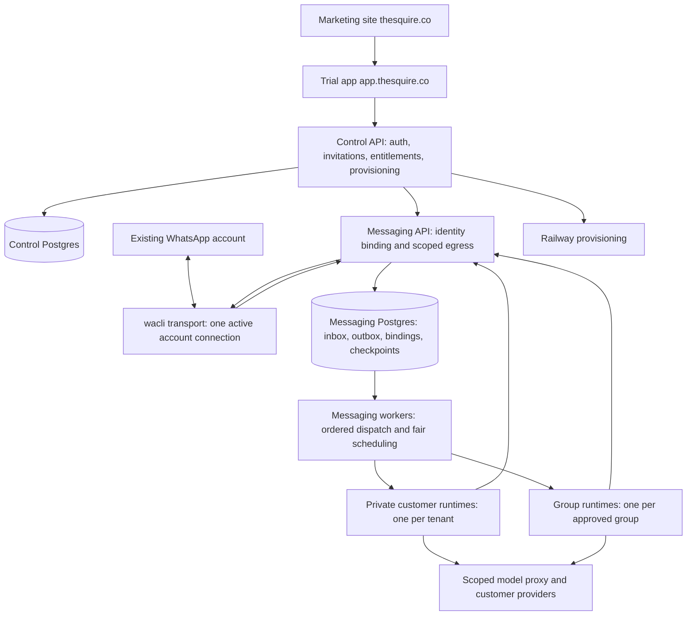

# Squire wacli pilot implementation plan

Date: 2026-11-15. Status: ready for implementation; no pilot services or account migration have been executed by this plan.

Build a working, invitation-limited product for **20 customers including Shaurya**, using the existing personal agent's WhatsApp account as Squire's shared sender. A new customer signs up on the website, receives the first WhatsApp message, verifies the connection, and talks to an isolated personal agent on a real trial. Customers can also add their agent to approved group chats. Shaurya's existing agent, memory, credentials, and approved groups move onto this infrastructure before the second customer is admitted.

This plan supersedes the Cloud API transport choice for this pilot and the earlier exclusion of unofficial WhatsApp. It retains the existing decisions to use one number, isolate customers, keep conversation content out of control-db, and build Squire's runtime changes through a versioned overlay. It does not reopen account-choice approval. A customer pilot and a production-scale WhatsApp transport are separate acceptance milestones.

## 1. Completion contract

The implementation is complete only when all of these have been demonstrated on the deployed services:

- [ ] Shaurya signs into the production website and sees his imported account and existing agent, without creating a duplicate tenant or restarting his trial.
- [ ] The existing agent number is paired to the production wacli transport. Shaurya's distinct personal WhatsApp identity routes to his private runtime.
- [ ] Shaurya's existing conversation continuity, memory recall, connected tools, scheduled jobs, and approved group behavior pass the migration checks in section 10.
- [ ] A second person, whose number has never contacted the agent account, uses the website invitation, verifies email, enters their number and consents, and **receives an automatic first WhatsApp message before sending anything to the agent**.
- [ ] That person verifies the WhatsApp code in their authenticated browser, receives their agent's introduction, sends a request, and receives a useful reply from their own isolated runtime.
- [ ] That person adds the same Squire number to a group, completes group approval, and receives a contextual reply there. Private DM content and credentials remain inaccessible to the group runtime.
- [ ] Restarting transport, workers, and either customer runtime does not lose durably accepted work or duplicate completed agent actions in the tested failure cases.
- [ ] Trial limits, expiry, opt-out, deletion, backup restore, outage reporting, and the 20-seat limit work without direct database edits.
- [ ] Actual end-to-end delivery is evidenced by receipts or recipient confirmation. A CLI exit code, queued job, HTTP 200, or WhatsApp acceptance is insufficient.

First-contact delivery is an early feasibility check when a separate consenting fresh canary exists, and a mandatory final website test. When the only fresh recipient is the reserved second tester, keep this requirement pending until founder activation and the 24-hour soak; it does not block source fencing. If the provider prevents it, record the failed requirement and leave wider outreach closed. The user-initiated connection fallback is a useful degraded experience, not a substitute for this completion contract. Do not report a fully working signup-first pilot based only on messaging Shaurya, an existing contact.

## 2. Verified starting point and dependencies

### Repository and deployed services

| Area | Current evidence | Work required |
|---|---|---|
| Website | `apps/web` is static HTML/Caddy; `public.py` exposes only `/waitlist` | Add a real authenticated trial application and connect the marketing CTA |
| Provisioning | Internal CLI/API provisions Railway tenants, always claiming a Telegram pool bot | Make channel selection explicit; WhatsApp must not consume a bot |
| Runtime | Squire Dockerfile pins Hermes v2026.8.3; existing deployed tenants span 0.1.7–0.2.12 | Complete overlay prerequisites and build a migration-compatible runtime |
| Personal agent | Local bootstrap manifest pins Hermes v2026.9.24; last deployment log records overlay 0.5.1 | Read the live host at implementation start; preserve its actual versions and data |
| WhatsApp Cloud work | Untracked `apps/ingress/src/ingress/whatsapp.py` and tests; router not mounted | Preserve this work as a future provider adapter; do not disguise wacli payloads as Meta callbacks |
| Internal auth | Fleet-wide `INTERNAL_API_TOKEN` is handed to tenants | Replace privileged cross-service access with scoped principals before adding customers |
| Trials | LiteLLM virtual keys exist; configured defaults are 72 hours and $10 per tenant | Add website lifecycle, actual daily turn accounting, group aggregation, and expiry enforcement |
| Schema | SQLModel `create_all`, no migration framework | Add versioned migrations and rehearse upgrades on a restored database |
| Backups | Tenant script can exit successfully when unconfigured; copies live PostgreSQL files | Require configured, consistent, independently restorable backups |

Railway inventory read on 2026-11-15:

- `squire-prod`: project `a97a9074-9f2e-495a-ba19-84594c65acbd`, environment `e921611e-edc6-44f6-b538-185da4bd4fa1` (`production`), currently empty.
- `squire-staging`: project `ddbcfda7-e6f6-47a9-87cd-903b6efeb8c6`, environment `0923ea14-9a5e-4d87-990b-be31e5bc76ed` (also named `production`). Contains web, control-api, ingress, trial-proxy, two databases, and five existing tenants.
- `thesquire.co` and `www.thesquire.co` are attached to staging's `web` service. Two old repository/branch changes are staged there. Inspect and reconcile that existing patch explicitly; never accept it incidentally with pilot work.

Build the pilot in the existing **squire-prod** project. Keep existing staging tenants and waitlist data intact. Serve the new app at **app.thesquire.co**; the marketing site's trial CTA links there. The app has its own Caddy service and same-origin `/api/*` proxy to production control-api. This avoids moving the existing domain, copying the waitlist, or assuming cross-project private DNS works.

Repository evidence: [research handoff](whatsapp-integration-research.md), [overlay sequence](overlay-phase3-plan.md), [migration handoff](overlay-migration-handoff.md), [personal-agent assessment](personal-agent-port-assessment.md), [existing implementation plan](implementation-plan.md).

### Required inputs captured during implementation

Record these in an operator manifest with secret references, not secret values:

1. Live agent account identity and the owner's separate WhatsApp identity; verify this is the dedicated agent account, not an assumption based on a display name.
2. Live VPS access, runtime/overlay commits, storage and database versions, state locations, active scheduled jobs, approved group identities, and tool dependencies.
3. Access to the account's primary phone for one new linked-device pairing and later recovery. Baileys session files will not be converted into whatsmeow credentials.
4. Production email sender and DNS verification for passwordless signup, using Resend; API keys go directly into service secrets.
5. Production model-provider funding, tenant-scoped trial keys, embeddings/transcription funding if enabled, and a configured backup destination with separate recovery-key custody.
6. DNS control for `app.thesquire.co`, GHCR pull access, and repository deployment secrets scoped to the actual production project.
7. The external tester's accepted invitation and consent to the automatic WhatsApp welcome. Reserve this tester's never-contacted number for the actual website test. Use a separate consenting canary identity for an earlier first-contact spike if available; otherwise keep that gate pending until the website flow exists. Live sends use only the founder and specifically consenting testers until admission opens.

External account authentication, phone linking, and tester actions are human steps in the runbook. Prepare their screens and commands before handoff; never ask for passwords or session databases in chat.

## 3. Pilot product decisions

| Decision | Pilot behavior |
|---|---|
| Seats | 20 accepted customers total, including the founder; 19 fresh-customer invitations. Expiry does not automatically create an unlimited stream of replacement trials. |
| Website authentication | Email one-time code, secure server-side session; no password or Google OAuth requirement for this pilot |
| WhatsApp identity | One shared Squire account and display profile. An agent name can appear in replies; separate customer identities cannot be represented as separate WhatsApp profiles on one number. |
| Trial | 72 hours, no card; 75 admitted assistant turns per trial-day across DM and groups; $10 total model budget per new trial |
| Founder | Imported existing customer, exempt from trial expiry; existing provider access remains isolated to his runtime |
| Trial start | At the first customer turn durably admitted after phone binding and runtime readiness; signup and provisioning time do not consume the trial |
| Group allowance | Initially one approved group per new customer, configurable. Preserve all inventoried approved founder groups as explicit migration exceptions. |
| Group identity | Exactly one sponsoring tenant per WhatsApp group. Multiple Squire customers may be members, but there is one selected agent in that group. |
| Group participation | Default: explicit address or reply to Squire. Optional owner/admin-approved participation in every message, with bounded replies and a pause control. |
| Included messaging | Text, reply context, supported mentions, voice-note input, ordinary images/files with bounded handling, and scheduled messages; implement founder-used outbound media capabilities before cutover |
| Deferred | Automated paid checkout, multiple agents simultaneously in the same group, new customer-created communities/channels, WhatsApp calls, bulk campaigns, automatic number replacement, and active-active account sockets |
| After trial | Stop paid inference and scheduled sends; preserve a fixed status response and website request-extension/delete actions. Operator extensions are explicit, audited, and budgeted. |

The existing website's detailed promises must match the implemented trial limits. A usage ceiling means “up to”; the $10 model cap may end model use before the turn allowance. Infrastructure and non-model provider costs are separate.

## 4. Customer journeys

### Signup and the first outbound message

1. Customer opens an invitation from `thesquire.co` into `app.thesquire.co/trial`. A single-use invitation is bound to the intended verified email; use fragment-to-POST exchange so raw invitation secrets do not enter access logs.
2. Customer verifies email with an eight-digit code. Codes expire after 10 minutes, permit five verification attempts, and have resend/rate limits. Store only keyed hashes. Use generic responses to avoid email enumeration.
3. Customer enters name, timezone, and an international phone number, confirms the formatted number, and explicitly opts into Squire WhatsApp messages and the trial policy. Capture consent version/time.
4. Server atomically reserves a seat and a unique signup operation. A browser retry returns the same operation. Unverified reservations expire after 30 minutes and cannot overrun the 20-seat cap.
5. Queue one **generic first-contact message**, without private agent content: “Hi, this is Squire. Your setup code is 12345678. Enter it on the Squire page to connect your assistant. If you didn't request this, ignore this message or reply STOP.” Code lifetime and attempts match the website's phone-verification challenge.
6. Browser shows actual states: waiting to send, accepted by WhatsApp, delivery reported, verify your code, preparing your agent, ready, or connection needs attention. It never labels provider acceptance as delivered.
7. Entering the WhatsApp code in the authenticated browser proves access to that recipient account. Atomically bind its verified identity to the tenant and consume the challenge. A phone already bound elsewhere causes a recovery flow, never reassignment.
8. Provision the tenant after verification, or resume the existing idempotent provisioning job. No personalized conversation is sent before verification. When its adapter is ready, queue a deterministic introduction and notify the browser. The first real user turn starts the trial and goes to that tenant.
9. A bounded send failure or no delivery report after 30 seconds exposes “Open WhatsApp to connect” without automatically resending an uncertain first message. The customer can send a high-entropy one-use binding nonce from a `wa.me` link. Bind only the sender authenticated by the transport and the logged-in signup session; confirm a differing phone before accepting it.

Phone verification, signup state, and outgoing setup messages are handled by deterministic services, never by the LLM. Disable link previews for setup messages. Rate-limit by verified account, invitation, recipient hash, and trusted client address so signup cannot become a messaging endpoint for arbitrary numbers.

The fallback is always available as recovery. The normal outbound-first flow must still pass with the second tester before launch is marked complete. Escalation on a provider restriction pauses sends; it does not rotate accounts or repeatedly hammer the recipient.

### Returning customer and account controls

The status page shows their agent state, masked linked number, trial time/usage, approved groups, and connection status. Provide resend only for a definitely-unsent/expired challenge, opt-out, group pause, sign out, request extension, and account deletion. Changing the number requires fresh website authentication plus verification of the new identity; revoke the old binding and outstanding sends atomically.

### Adding an approved group

1. From their authenticated website or bound owner DM, the customer chooses Add group and receives a short-lived, single-use claim nonce. A pending claim consumes no permanent group allowance.
2. They ask a group administrator to add the existing Squire number using WhatsApp's normal UI. Membership alone does not activate the agent.
3. The bound owner posts the claim command in that group. Verify the real sender, group JID, current membership, tenant entitlement, and nonce. Resolve phone/LID equivalents only from authenticated protocol evidence.
4. Fetch fresh group metadata. If the owner is an administrator, their claim can authorize the group. Otherwise require an explicit confirmation from a current group administrator. Stale metadata cannot authorize ownership or administration.
5. Atomically create a unique group binding. If another tenant already sponsors the group, explain the conflict privately; never let the last claim steal it or run two customer agents behind the same number. Transfer requires both current and new owners, renewed administrator approval, and explicit handling of existing group state.
6. Provision a separate group runtime. Post a fixed disclosure that this is the sponsoring customer's Squire agent, describe what it can see, and explain how to address/pause it. Enable replies only after this succeeds.
7. Default response triggers are a verified mention, a reply to a known Squire message, or the explicit `!squire` prefix. Validate actual mention/reply fields from the pinned binary; name matching is not authentication. An every-message mode requires a deliberate setting and is still rate-limited.
8. Removing Squire, revoking approval, owner removal, administrator pause, sponsor expiry, or `!squire stop` from an authorized administrator disables new turns and queued sends. Re-check entitlement and binding generation immediately before send.

Website/DM revocation is immediately authoritative in Squire. WhatsApp membership changes take effect when the transport observes them; the implementation must measure this delay and invalidate cached membership on change/reconnect. A stale participant snapshot never grants an administrative action. P0 must establish how current group metadata is obtained while sync owns the store. If the pinned binary cannot expose the needed live metadata safely, add a narrowly tested group-info delegation change to the pinned transport build before enabling group claims; do not weaken authorization or depend on unrestricted commands from tenant agents.

Other members can converse in the approved group without becoming Squire customers. Their DMs to the shared number do not route to the sponsoring customer's private agent. A group member who is another Squire customer keeps their own DM binding; group messages still route solely to the group's sponsoring runtime.

## 5. Architecture and trust boundaries

### Services

| Service | Responsibility | Pilot deployment |
|---|---|---|
| `app-web` | Static trial/status pages, same-origin API proxy, security headers | Public HTTPS; no privileged credentials in browser |
| `control-api` / `control-db` | Accounts, sessions, invitations, runtime placement, lifecycle, quotas | Existing FastAPI patterns; migrated production Postgres |
| `provision-worker` | Leased provisioning and lifecycle jobs | Same code/image, separate worker entrypoint |
| `messaging-api` | Binding and inbound acceptance; scoped outbound requests; group authorization | Private service, no public unauthenticated send API |
| `messaging-worker` | Dispatch, entitlement checks, retries, reconciliation, fair send scheduling | Bounded concurrent work; PostgreSQL leases |
| `messaging-db` | Durable payloads, identities, delivery state, checkpoint ownership | Separate database and service credentials from control-db |
| `wacli-transport` | Owns wacli session and local mirror; supervised sync, journal reader, command broker | One replica with persistent volume; always on |
| `trial-proxy` / `litellm-db` | Metered trial inference with per-runtime credentials and tenant aggregate budget | Production instance with logging of message bodies disabled |
| `tenant-*` | Private DM agent, tools, memories, provider credentials | Separate service and volume per customer |
| `group-*` | Approved group's conversations, group memory and restricted tools | Separate service and volume per group; lazy provisioning |

Use the existing production project and an appropriate region after checking volume/runtime compatibility. Keep transport, databases, control, and messaging workers always on. Initially keep private customer runtimes warm for predictable onboarding; group runtimes may sleep only after the wake/replay tests pass. Do not promise a latency target supported only by sleeping-tenant assumptions.

### Group isolation is a runtime boundary

Separate session keys inside one fully privileged personal agent are insufficient. A group prompt must not be able to read the owner's personal files, memories, browser sessions, credentials, or DM history.

Each group runtime has its own HERMES_HOME, volume, memory bank, restricted model credential, and egress principal. It receives a sanitized agent persona and group-specific brief, not a copy of private customer state. Its model usage is billed against the sponsor's entitlement. It can use only explicitly group-safe tools; no mounting the owner's home, cloud credentials, or browser profile.

When a group needs an owner-only action, create an approval request to the owner's DM. The private runtime performs the authorized action, and its result remains private until the owner explicitly releases a selected result back to the group. A general approval must not grant the group persistent access to private credentials. Approvals carry group/runtime/action IDs and a TTL and cannot be replayed across customers.

Migrate existing founder group conversation state into the relevant group runtime only. Do not seed it with the founder's mixed private memory database. Existing group automations depending on private tools must be converted to the approval/result-sharing flow and verified before calling migration complete.

### Principal and API contracts

- Browser principal: authenticated account plus CSRF protection; derive tenant ownership server-side.
- Operator principal: provisioning, migration, and account-management capabilities; never installed in agent containers.
- Runtime principal: one runtime and owner tenant, with explicit private-DM or group scope and revocable generation.
- Messaging worker principal: dispatch and send-claim capabilities; cannot change customer billing or provision arbitrary resources.
- Transport principal: fixed provider account; authenticated ingest and broker requests only.

Replace fleet-wide token checks for new and migrated runtimes. Enumerate every call made by heartbeat, trial conversion, credential-connect, provisioning, and the shim. A customer runtime cannot list the fleet, obtain another binding, provision services, revoke another tenant, or impersonate another runtime. Private networking is not authorization.

Proposed stable contracts, versioned under `/v1`:

| Boundary | Contract |
|---|---|
| Browser → control | `/auth/code`, `/auth/verify`, `/trial`, `/me`, `/phone/challenge`, `/phone/verify`, `/groups/claims`, `/account/delete` |
| Transport → messaging | `/ingest/batches`: normalized events plus provider/store identity and checkpoint; atomic acceptance |
| Messaging → runtime | `/events`: bounded signed event batch; acknowledge only after tenant-local durable inbox commit |
| Runtime → messaging | `/outbound`: conversation ID, logical response key, bounded payload/media reference; recipient resolved by server |
| Runtime → control | Scoped heartbeat, entitlement status, and provider-connected notification for that runtime only |
| Control → messaging | Idempotent binding/lifecycle commands with operation IDs and binding generations |
| Operator | Inventory, provision retry, transport pause, reconcile, migrate, restore, admission changes; auditable CLI |

Normalized inbound envelopes include version, event ID, provider account ID, provider message ID, canonical conversation ID, authenticated participant ID, DM/group kind, payload reference, provider timestamp, local observed time, and origin classification. Routing never trusts a tenant ID, phone number, quoted sender, group title, or command argument supplied in message text.

### Provider replacement boundary

Implement an internal `MessagingProvider` interface for readiness, account identity, ingest/replay, send result, receipt normalization, media retrieval, and group capabilities. Tenant adapters consume Squire envelopes and call Squire egress; they do not call wacli directly.

Future Cloud API or another transport can replace the provider while preserving customer accounts, runtimes, conversation IDs, queues, and quotas. A future provider may lack the same group or phone-identity features: capability discovery and a migration plan are required. Do not promise that the current number or approved groups can be moved to Cloud API without restrictions or downtime.

## 6. Durable messaging design

### Version and ownership

Start evaluation from wacli **v0.26.0**, resolve its exact commit and artifact SHA-256, and record both in the build manifest. Verify the shipped binary's features rather than relying only on latest online documentation. Apply required security fixes through a new reviewed pin before customer rollout. No floating `latest`, per-request downloads, or copied developer sessions.

One supervised `sync --follow` owns the account store. A private command broker on the same service invokes supported commands with argument arrays, never shell interpolation. It validates recipient/capability assertions, enforces deadlines, and strips payloads from logs. The account's session database and delegate socket are accessible only to this service.

Commands that cannot run while sync holds the store lock need a broker-controlled pause/drain/resume operation. In particular, test live group-info/refresh/leave and local retention commands alongside continuous sync; do not assume every CLI write delegates. Pause new sends, complete active operations, stop sync, run the bounded command, restart, then replay. Never open a second independent socket to bypass a lock. Longer-term delegation improvements can be an upstream contribution.

### Inbound acceptance and recovery

The pinned CLI documents a payload-free `messages changes` journal with store identity, sequence checkpoints, bounded drains, and explicit expiry. This is distinct from list/export cursors, which can invalidate during writes. Use the journal for recovery, with signed webhooks only as a latency optimization. [Pinned message reference](https://raw.githubusercontent.com/openclaw/wacli/v0.26.0/docs/messages.md)

Implement this sequence:

1. Bootstrap the store and capture a checkpoint before activation. Establish per-conversation activation boundaries and a baseline manifest for the founder's imported history. Old history never starts new tasks or replays old reminders.
2. Drain journal changes from the committed checkpoint. Fetch each event's current retained payload; normalize identity moves and tombstones. Upserts update the indexed revision; an already-processed message does not become a fresh turn because it was edited or re-imported.
3. Submit a bounded batch to messaging-api. In one messaging-db transaction persist event uniqueness, permitted encrypted payloads, routing disposition, processing status, and the next checkpoint. A failed transaction advances nothing.
4. Deduplicate journal entries by store ID and sequence, and logical inbound work by account + canonical conversation + provider message ID. Webhook and journal observations converge onto the same logical event. Keep identity aliases so phone/LID moves cannot cause a second agent turn.
5. Ignore outbound echoes, status broadcasts, calls, and delivery receipts as agent prompts. Group events require an active group binding; unknown DMs can only exercise the deterministic pending-signup/opt-out flow. Record minimal rejection metadata and discard unauthorized payloads.
6. Dispatch in order within a conversation, concurrently across conversations. A tenant-local durable inbox deduplicates event IDs before an agent turn. Persist turn status, produced response keys, and tool-operation identities so restart does not blindly rerun a completed turn.
7. If a checkpoint expires, pause affected processing, capture a fresh checkpoint, reconcile a retained snapshot, then drain changes from that anchor. Report any unrecoverable interval; archive completeness is not a provider delivery guarantee. Never silently reset to “now.”

Bootstrap origin classification and late history arrivals require fixture and live tests. Use the activation baseline and known message IDs; do not use message timestamps as the replay cursor. Historical content outside the activation boundary can be retained for the founder's migration but cannot authorize a task. A message whose origin cannot be established is quarantined for reconciliation rather than executed twice.

Edits/revocations update retained context and pending work when possible. They do not retract already-completed external actions. The change journal is a latest-state recovery mechanism, not a record of every intermediate content revision; expose a content-unavailable event if it was purged before retrieval.

### Queues and ordering

Use PostgreSQL inbox/outbox tables, transactional uniqueness, `FOR UPDATE SKIP LOCKED`, expiring leases, fencing generations, and bounded backoff. Control provisioning and messaging have separate databases, so cross-service changes use durable command outboxes with idempotent consumers; do not pretend there is a distributed transaction.

Initial configuration: four independent runtime dispatches; one in-flight turn per conversation; one account send operation at a time; round-robin fairness across tenants; reserve capacity for interactive replies over scheduled summaries. Start at one outbound operation per second, then adjust only from observed queue age and provider feedback. This is an application pacing choice, not a claim of a safe WhatsApp limit. Set a 200-item per-tenant pending-work cap and an overall cap; apply backpressure and close new admission before storage exhaustion.

Retries reuse the same event or response key. A worker that loses its lease cannot finalize or send under an old generation. Exactly-once side effects cannot be inferred from message deduplication: tool actions need their own operation IDs and outcome reconciliation. Uncertain non-idempotent tool actions go to an owner-visible recovery state.

### Outbound and receipts

Outbox states: `queued → claimed → dispatching → accepted → delivered → read`; terminal alternatives `failed`, `cancelled`, `expired`, and `uncertain`. A returned provider message ID moves to accepted. Persist observed delivery/read transitions monotonically and keep group receipt counts distinct from delivery to every participant.

Before dispatch, verify current binding generation, customer entitlement, group approval, opt-out, and allowed payload type. Resolve destination from the authenticated runtime's conversation grant. A caller cannot supply an arbitrary raw JID or phone number. Group runtimes can send only into their group; approved private-to-group sharing goes through the explicit release operation.

If the process dies after network submission but before recording the result, mark the outcome uncertain. Do not automatically resend. Reconcile using available provider IDs, stored outgoing records, timestamps and exact payload fingerprints, but do not treat a non-unique match as proof. For the pilot, unresolved cases require operator/owner recovery. If a send succeeds but local archive persistence fails, retain its returned ID and never resend merely to repair the archive. [Send semantics](https://wacli.sh/send.html)

Receipt webhooks are also fallible. Reconcile known outgoing message IDs against the retained receipt store, while recognizing that unobserved receipts cannot be recreated. “No receipt” remains unknown delivery, not failure. A signup code successfully entered by its intended account supplies separate delivery evidence.

### Media, retention, and session operations

Media downloads happen in transport with allowlisted commands, 10 MiB pilot input limits, verified content type, timeouts, and no user-controlled local paths. Outbound decoded attachments also have a 10 MiB limit. Forward opaque, short-lived media capabilities tied to one runtime and conversation. Voice transcription and document/image processing happen within the authorized runtime or its scoped provider path. Unsupported payloads get a bounded explanatory response, not a blank agent turn.

Payload retention defaults:

| Store | Retention and access |
|---|---|
| Control DB | Account/auth/consent/lifecycle metadata; no message bodies, phone plaintext, model prompts, or user provider secrets |
| Messaging DB | Encrypted active payloads; purge within 24h after successful dispatch/completion; pending/failed payloads at most 7 days; minimal receipt/dedup metadata 30 days |
| wacli mirror | Account-wide service data, never mounted in a tenant; purge eligible message payloads after 7 days or a shorter disappearance setting, only after durable capture |
| Transport media | Delete after authorized retrieval or 24h; shorter for disappearing content |
| Private runtime | Customer conversation/memory lifecycle; separate encrypted backups |
| Group runtime | Group-scoped history/memory; no private customer-state copy |

`store cleanup --days` removes inactive chats, not all old messages in active chats, so it is not enough for message TTLs. Implement a retention job using verified local payload-purge operations, and test its interaction with journal checkpoint expiry before enabling it. Never prune uncaptured work just to keep sync running. Storage caps may stop ingestion; alert well before reaching them. [Store reference](https://wacli.sh/store.html)

The mirror contains readable account conversations while the service runs. Disk/backup encryption is not end-to-end secrecy from the operator. State this accurately in the pilot privacy notice, including group processing. Keep raw wacli logs, argv, QR codes, phone numbers, messages, media keys, and session data out of shared telemetry and deployment output.

Watch actual process/connectivity state, terminal logout, journal progress, queue age, free disk, and pending send outcomes. A quiet account is healthy; an old activity heartbeat alone is not a reason to restart. A remote logout can exit cleanly, so process exit code alone is not readiness. [Sync reference](https://wacli.sh/sync.html)

## 7. Data model and lifecycle

### Control database additions

Introduce migrations with explicit allowlisted columns and update privacy-schema tests deliberately.

- `account`: verified email, status, creation time; account IDs separate from tenant IDs.
- `auth_challenge` and `web_session`: hashed codes/session tokens, expiry, attempts, revocation; no plaintext credentials. Secure, HttpOnly, SameSite cookies, host-only scope, session rotation, CSRF/origin checks.
- `pilot_invitation` and `pilot_admission`: intended account/email, hashed invite, reservation expiry, consumed/accepted state; serialize against a capacity row so concurrent signups cannot exceed 20.
- `tenant`: account FK, channel, entitlement, imported/fresh flag, runtime placement; retain Telegram fields for existing tenants without requiring them for WhatsApp.
- `runtime`: private/group kind, tenant owner, opaque conversation scope, service/volume IDs, image/overlay versions, readiness, credential generation. Raw group identities belong to messaging-db.
- `trial_entitlement`: activated/expires timestamps, trial-day turn counters, shared DM/group budget, status, extension history. Aggregate spending cannot be reset by creating a group.
- `provision_job` / `lifecycle_job`: leased state machine, idempotency keys, attempt count, compensation state; no secret-bearing free-form errors.
- `service_principal`: hashed credentials/capabilities and rotation metadata.
- `control_command_outbox`: fixed command types and bounded metadata references for cross-service coordination.

### Messaging database additions

- `provider_account`: stable Squire account ID, provider/version, readiness, leader generation, opaque secret reference.
- `recipient_identity` / `identity_alias`: HMAC-indexed address, encrypted routing address, authenticated phone/LID mapping and provenance.
- `binding`: owner tenant, scope, active/revoked state, binding generation; unique active DM recipient per account.
- `phone_challenge`: hashed code, signup/account link, encrypted destination, TTL, attempts, delivery operation ID.
- `group_claim` / `group_binding`: group identity, sponsoring tenant, verified owner/admin evidence, approval/membership freshness, mode, runtime, revoked generation; unique active group per provider account.
- `inbox_event`, `conversation_work`, `outbox_message`, `delivery_event`: payload ciphertext/reference, event/response uniqueness, ordering, leases, timestamps, bounded failure codes.
- `provider_checkpoint` / `provider_observation`: journal identity/sequence, alias transitions, baseline and reconciliation state.
- `media_object`: scoped capability, lifecycle, size/type, ciphertext reference, expiry.
- `pending_approval`: owner/group/action binding and release state; no implied permission from model text.

Migration tests run against PostgreSQL, including concurrent admission, unique active bindings, leases, and transaction rollback. SQLite-only tests cannot establish those properties.

### Trial enforcement

Use a 24-hour trial-day anchored at activation, with a unique counter increment per admitted user turn. Group background chatter that does not trigger the agent consumes no turn. Group and DM turns share one sponsor counter; scheduled inference still consumes model budget. Fixed setup/status messages do not consume assistant turns.

Provision without an active trial inference credential. On activation, mint/inject the 72-hour key idempotently, verify it, and release the first queued turn. Runtime readiness before activation means adapter/storage readiness, not permission to call the model. Configure group keys under the same tenant budget if the pinned LiteLLM version supports an enforced aggregate; otherwise implement that aggregate in the Squire model gateway before group trials open. Never give every group an independent $10 allowance.

Entitlement transitions: `reserved → verifying → provisioning → ready_unstarted → active → expired/paused → deleted`. Founder uses `imported_active`. Expiry independently disables messaging turns, cron dispatch, and provider keys, including for groups. Do not rely on a tenant cooperatively honoring its own limit. Binding verification expires at 30 minutes; verified-but-unstarted runtimes stop after 24 hours, retain resumable setup for 7 days, then release unused reservation/resources according to lifecycle policy.

No automated paid conversion is needed to pass the pilot. Expired users can request a deliberate extension. Connecting a personal model provider does not silently bypass the product entitlement or group isolation rules.

## 8. Implementation work packages

Implement in this order. Each package has a concrete output and an exit gate; do not mark later packages complete because scaffolding exists.

| Package | Changes and primary files | Exit gate |
|---|---|---|
| P0 Inventory and transport feasibility | New `infra/pilot_inventory.py`; live founder inventory; pinned wacli image/broker spike; production resource manifest | Account identity confirmed; authorized fresh-canary receipt recorded, or first-contact check explicitly deferred to P10 when only the reserved tester is available; group receive/send and authenticated sender fields verified; exact feature/version manifest recorded |
| P1 Durable transport | New `apps/whatsapp-transport/` with Dockerfile, supervisor, broker, journal reader, receipt reconciliation, retention, health; integration tests using pinned CLI | Lost webhook recovered; restart resumes checkpoint; unknown/expired journal explicit; command-lock behavior tested; no sends while leader fenced |
| P2 Storage and service authorization | Control migrations/auth modules; new `apps/messaging/` API/worker/model/migration packages; update existing auth consumers | Two independent tenant principals cannot access each other's data or any operator capability; DB failure accepts no unpersisted batch |
| P3 Runtime foundations | Execute `overlay-phase3-plan.md` prerequisites, then compatible Hermes base migration; `tenant-image/overlay/`, Dockerfile, CI, managed config | Prior canary and fresh tenant pass; rollback image/state restore proven; founder's used features have documented parity |
| P4 Squire messaging adapter | Plugin platform adapter, durable runtime inbox, scoped egress client; `squire-webhook-shim.py`, heartbeat, connect, concierge, cron routing | Private DM round trip, stream suppression, duplicate replay, media, restart, provider connection and scheduled message pass |
| P5 Groups | Group bindings, admin/owner claims, policy; group runtime image profile, scoped memory/tools, approval/release flow | Customer can approve a group and use the agent; attacks cannot access private state; removal/pause cancels queued sends |
| P6 Provisioning and trial lifecycle | `models.py`, `schemas.py`, `provisioning.py`, `trial_keys.py`; new worker/lifecycle modules and operator commands | WhatsApp trial provisions with zero Telegram bots; crash resumes; actual 72h/quota behavior and aggregate group budget enforced |
| P7 Website | New `apps/pilot-web/`; public/authenticated control routes; production email; marketing CTA/privacy/FAQ edits | Browser-only signup to first WhatsApp text, verification, status, group management, opt-out and deletion pass |
| P8 Production deployment and operations | CI build/deploy entries, production service creation/config, DNS, backups, alerts, operator runbook | All intended deployment IDs reach SUCCESS; private surfaces reject unauthorized traffic; restore and pause drills pass |
| P9 Founder migration | New `infra/migrate_personal_agent.py`, import/export manifests, dry run, cutover/rollback journal | Founder private agent and approved groups serving on production; old writers disabled; parity and recovery gates pass |
| P10 Second customer and cohort | Browser/live test harness, redacted evidence manifest, admissions controls | Second fresh signup passes first-contact and group tests; then admit in rings 2 → 5 → 10 → 20 |

P0 and P1 come first to discover provider limitations before building the whole product. Independent code can be prepared while runtime work proceeds, but deployment order and migration gates stay sequential. If no separate fresh canary number is available, reserve the second tester for P10 using P7's website flow and mark first-contact feasibility pending. Founder migration may proceed once its separate parity, isolation, scheduler, media, group and rollback prerequisites pass. After founder activation and a verified 24-hour soak, allow only the reserved invitation through test admission. Wider admission and the completion contract remain blocked until the live website test and remaining acceptance checks pass. The implementation does not require multiple agents.

### File-level scope

Extend existing files:

- `apps/control-api/src/control_api/{auth,config,db,models,schemas,provisioning,trial_keys,main}.py`
- `apps/control-api/src/control_api/routers/{public,internal}.py`; introduce separate browser-session and scoped-runtime routers rather than exposing internal endpoints.
- `apps/control-api/tests/` including privacy schema, state machine, auth, trial, and cross-service contracts.
- `tenant-image/{Dockerfile,supervisord.conf}`, its entrypoint, shim, heartbeat, credential-connect, backup, and concierge files.
- `apps/web/site/{index.html,privacy.html,llms.txt}` and relevant FAQ structured data when the pilot is ready.
- `.github/workflows/deploy.yml`, tenant-image CI, and new transport/messaging image workflows.

Create:

- `apps/control-api/migrations/` and a production migration command.
- `apps/pilot-web/` with trial, verification, status, groups, and account-control pages and browser tests.
- `apps/messaging/` with separate API and worker entrypoints, typed contracts, PostgreSQL migrations, and tests.
- `apps/whatsapp-transport/` with a pinned wacli build, private broker, capture/reconciliation, retention, and test fixtures.
- `tenant-image/overlay/plugin/squire_overlay/` modules for the transport adapter, private/group runtime profiles, durable inbox, conversation scope, and approval release.
- `infra/pilot_inventory.py`, `infra/pilot_ops.py`, `infra/migrate_personal_agent.py`, and deployment/restore manifests.
- `docs/runbooks/wacli-pilot.md` and `docs/runbooks/founder-migration.md` as implemented operational procedures, with actual version references and verified commands.

Preserve the currently modified research file, untracked Cloud webhook code/tests, and control-api lockfile. Reconcile their changes before committing; do not discard them or overwrite them with this plan.

## 9. Runtime compatibility and prerequisites

The existing overlay sequence remains a dependency: establish the rollback floor, plugin-managed customization boundary, and canary evidence before changing the Hermes base. Carry forward existing mandatory behavior and tests; do not assume the personal plugin can run unchanged in a Railway container.

At P0, read the live personal runtime version and compare it with the local v2026.9.24 reference. Build the pilot on a pinned baseline that can read that state. Do not downgrade a newer personal state database into Squire's v2026.8.3 image. If a forward migration is necessary, rehearse it on a copy and keep the original backup plus matching original runtime available.

Port personal-agent capabilities through the overlay: home-channel identity, memory configuration, task progress scoping, ignored conversations, approval routing, tool deadlines, and recovery. Translate systemd/cgroup-specific isolation deliberately: Railway container resource limits and separate group runtimes are available boundaries; nested systemd user scopes are not assumed. Validate tool-process cleanup and memory pressure without claiming rlimits equal the original cgroup controls.

The new Squire adapter must preserve the founder's existing logical DM/session identity and map group history into group-specific runtimes. Keep a tested old-to-new session alias map and migrate embedded channel destinations in cron/approvals. The adapter must not import Baileys credentials or instantiate the old Baileys socket. Determine the supported platform-registration seam with a contract test against the chosen Hermes source; if replacement of the `whatsapp` platform is unsupported, use a named Squire platform with an explicit session-state migration rather than monkey-patching the live base.

Secrets inventory covers `.env`, Hermes `auth.json`, Claude credentials, derived Codex files, browser profiles, tool OAuth stores, SSH keys, skill-local credentials, and external CLI homes actually used by the founder. Migrate only the founder runtime's required secrets over an encrypted path; exclude transport credentials from private/group containers. A secret that cannot be safely transferred gets a prepared reconnect step before parity signoff, not an assumed migration.

Memory compatibility includes Hindsight/PostgreSQL versions, memory bank IDs, embedding model and dimensions, filesystem paths, and provider configuration. Matching vector dimensions alone does not preserve embedding semantics. Use the existing model or perform a controlled re-embedding and validate recall. Do not copy a live PostgreSQL data directory with restic and call that a consistent backup.

## 10. Founder migration and rollback

### Preparation while the old agent serves

1. Inventory without logging contents or secrets. Record artifact versions, file categories/counts, DB schemas, workspace paths, cron definitions/timezones/destinations, connected tool names, and approved groups.
2. Create the founder account in production, consume pilot seat 1, set `imported_active`, and bind the owner's verified personal identity. Signing in later returns this account.
3. Build a compatible candidate private runtime and one group runtime per approved group, with all transport, scheduled jobs, and external side effects disabled.
4. Produce a consistent encrypted rehearsal snapshot: SQLite backup API or stopped writers; logical PostgreSQL dump/restore with matching clients; symlink-aware files; encrypted secret transfer. Preserve browser/session requirements deliberately.
5. Import into the candidate. Compare manifests and run offline checks plus safe tool-read tests. The candidate cannot send messages or run scheduled writes during rehearsal.
6. Pair wacli to the same account as an additional linked device, with the broker's outbound gate off. Bootstrap with limited history and maintain a capture-only checkpoint. Do not unlink or destroy the existing Baileys session.
7. Run transport feasibility using only authorized canary identities. Prevent the legacy agent from responding to those specific canary chats through its existing allowlist/ignore mechanism before any canary message. The old agent remains the only responder for the founder's live conversations until cutover.
8. Rehearse rollback on an isolated restore. Require group-secret isolation, memory recall, and adapter/session mapping tests before booking cutover.

### Cutover with one writer

1. Close new admission and pause relevant proactive schedules. Record a durable cutover ID, timestamps, provider baseline/checkpoint, and old/new runtime identities.
2. Fence the old gateway's inbound processing and all old cron/tool writers. Pause its watchdogs so they cannot restart Baileys or the gateway. Confirm no in-flight external action remains unresolved; snapshot unresolved outcomes for reconciliation.
3. Keep wacli capture running, with replies disabled, so new messages accumulate durably during the state transfer. It must already have demonstrated active ingestion before the old responder stops.
4. Take the final consistent source snapshot after writers stop. Import the final delta into the new private/group runtimes; verify database integrity, state counts, identity mapping, and required secret mounts. Exclude old locks, PIDs, caches, release directories, and transport session files.
5. Activate the new routing generation and recipient grants. Enable the founder private/group runtimes first; drain only the approved post-boundary backlog. Keep imported historical messages inert.
6. Enable exactly one scheduler per migrated job. Reconcile executions around cutover and keep stable job IDs so a reminder does not fire from both environments.
7. Enable outbound from the new generation and perform founder checks: DM conversation continuity, known-memory recall, read-only calendar/email/tool task, a supervised side-effect task, voice/media, progress scoping, one scheduled message, an existing approved group, owner approval and explicit group result sharing.
8. Verify runtime restart and transport reconnect. Record actual message IDs/delivery evidence without recording message content. Keep the old runtime stopped but recoverable.
9. Founder soak: at least 24 hours with a successful scheduled job, no unexplained duplicate/missing messages, and clean group/private separation before admitting the second customer. Record the journal's `founder_soak` proof and advance from `active` to `tester_ready`, then deliver the reserved invitation and run the second-customer website test. Record exact live `first_contact` evidence and advance to `first_contact_verified`; this proof cannot be recorded before tester readiness. Wider admission also requires the second customer's approved-group checks and remaining acceptance checklist. Neither journal transition automatically changes service flags.

### Rollback

Rollback triggers include lost private memory/tool access, unexpected group exposure, unbounded duplicate turns, unreconciled capture gaps, or a runtime that cannot stay healthy.

- Stop new admission and fence new outbound/schedulers first. Snapshot the new system's post-cutover state, inbox/outbox, approvals, and side-effect ledger.
- For a runtime-only failure, keep wacli and its durable capture running; route the founder back to a verified compatible previous runtime only after replay/state reconciliation.
- For a transport rollback to Baileys, pause all pilot processing, restore only the founder's old allowlisted conversations, and keep every new customer's messages out of the founder agent. Notify affected testers through the website/email incident path.
- Restore the last compatible source snapshot and reconcile post-cutover changes and already-sent responses before replay. Never revert an image against an incompatible migrated database or blindly rerun a tool/cron operation.
- Prove the old responder is healthy and the new one cannot send before reopening founder traffic. Keep other customers paused until their isolated service is restored; the legacy personal agent is not a fallback for all customers.
- Retain the original host, session, and encrypted snapshot for 14 days after successful migration, with automatic cleanup disabled. Retire them only after restore evidence, parity, and the pilot operating period justify it.

## 11. Deployment, operations, and budget

### Deployment order

1. Re-read production/staging inventory, deployment workflows, secrets names, and pending changes; record explicit project/environment IDs in every operation.
2. Provision production databases, backup destination, trial proxy, control services, messaging services, and transport volume. Services boot with outbound and public admission disabled.
3. Run schema migrations as a dedicated deployment step. Do not use `create_all` to pretend existing columns were migrated. Verify restore and migration rollback/forward-repair procedures.
4. Deploy pinned runtime images and complete synthetic integration/failure tests. Production tenants are created only by the scoped provision worker.
5. Deploy `app-web` on a temporary Railway hostname, configure the production API and verified email sender, and validate browser flows without live outreach.
6. Configure `app.thesquire.co`, verify DNS/TLS/cookies and API origin boundaries, then complete founder migration and the consenting second-person test.
7. Update the marketing site's CTA, FAQ, privacy link, and structured metadata only after the production app passes. Existing waitlist remains available when the pilot is full or paused.
8. Release seats in rings. Hold each increase until observed delivery, queue age, runtime resources, and support burden support it. Do not load-test by sending a flood to real WhatsApp accounts.

CI must build/test transport, messaging, control, and runtime artifacts separately and preserve immutable digests. A production deployment is complete only after its specific deployment ID reaches SUCCESS and the service-level smoke checks pass. Prevent normal staging pushes from changing the production sender or migration data.

### Operational controls

Provide operator commands for `status`, `pause-admission`, `pause-outbound`, `pause-tenant`, `pause-group`, `reconcile`, `retry-definitely-unsent`, `extend-trial`, `restore-dry-run`, and `export-migration-manifest`. Commands show their explicit target environment and support dry runs where applicable. No arbitrary message sending from an unauthenticated admin page.

Alert on transport logout or repeated connection errors, checkpoint lag over 30 seconds, oldest interactive work over 30 seconds, failure growth, uncertain sends, trial-key revocation failures, capacity exhaustion, and backup failures. Send operator alerts through the configured email/operations channel so an outage does not depend on WhatsApp itself. Alerts contain IDs and counts, never conversations or raw phone numbers.

Use distinct controls for new signups, first-contact outreach, all outbound, one customer, and one group. A global provider restriction pauses every tenant's sends. Keep the account's primary-phone access maintained and documented; new device pairing is a human recovery step. Do not automatically switch numbers after a restriction.

Backup requirements: consistent database backups, encrypted tenant/group archives, encrypted session-store backup, separate key custody, and at least one full restore before founder migration. Target recovery time under one hour and backup recovery point within 24 hours for catastrophic volume loss; process restarts must recover all committed work. A daily backup does not justify a zero-loss claim for disk destruction. Preserve checkpoint/store consistency and prevent a restored transport from sending until reconciliation completes.

Delete-account flow immediately revokes bindings, sessions, outbound grants, scheduled sends, and model credentials. Destroy runtime data/keys and live message payloads within 24 hours after the deliberate deletion request; expire encrypted disaster-recovery archives within 30 days. Explain retention of minimal abuse/consent/accounting metadata. Group removal stops processing immediately; do not delete group history from other participants' devices.

### Budget and capacity

- New-customer model trial allowance: **19 × $10 = $190** maximum configured aggregate, assuming the model proxy's enforced accounting works as tested. Founder-owned provider spending is separate. Group runtimes share the sponsor's cap.
- Budget also covers infrastructure, email, backup storage/egress, and any separately billed embeddings/transcription. The $190 figure is not a total pilot cost.
- Before provisioning the full cohort, record measured idle/active memory, CPU and storage for one private and one group runtime, then price fixed services + 20 private runtimes + approved group runtimes using current Railway rates. Pin resource limits with enough headroom for the tested workload.
- Set operator-visible cost alerts and a cohort admission ceiling against that forecast. Do not apply a surprise global shutdown to an already-running customer simply because an alert fired.
- First capacity test: 20 synthetic customers, each with a DM and approved group, 20 simultaneous user turns, a 100-message scheduled burst, one slow runtime, and transport reconnect. Use a fake provider and test databases. No cross-customer leakage or accepted-message loss; interactive tenants must progress while another is slow.
- Initial service targets: p95 durable ingest under 500 ms; p95 queue-to-ready-runtime dispatch under 1 second at supported pilot load; warm text reply p95 under 15 seconds at steady load below 0.5 outbound operations/second, excluding extended tool work; new runtime ready within 3 minutes. For the 20-simultaneous-turn test, target replies within 90 seconds, with explicit fair progress. At the initial one-send/second pacing, 20 replies alone need at least 20 seconds of send capacity; the steady-load target does not apply to that burst. These are acceptance targets to measure, not current results or provider delivery guarantees.

Scale later by increasing stateless API/worker replicas, partitioning conversation work, pooling capacity for isolated group runtimes, and adding tenant placement controls. Preserve one ordered connection owner per provider account. A single-number WhatsApp account remains the transport bottleneck and shared failure domain even if our database and workers scale. Progress beyond 20 requires measured capacity and a provider/account strategy, not simply changing the seat constant.

## 12. Acceptance matrix

| Test | Required result |
|---|---|
| Fresh website signup | Verified email and invitation, one tenant, automatic first WhatsApp text actually received before inbound contact |
| First-contact restriction | Outreach pauses/reports failure; fallback works; primary acceptance remains unpassed |
| Phone typo / takeover | Generic challenge only; no private content; wrong owner cannot bind, overwrite, or enumerate another account |
| Repeated signup / concurrent seat claims | One job/account binding; twenty-first customer cannot consume a seat |
| Founder account import | Existing state, provider access, sessions and schedules preserved; login creates no new tenant |
| Private DM isolation | Two customers ask for unique seeded facts; each sees only their own; forged tenant IDs and recipient parameters rejected |
| Group activation | Owner plus required admin approval; membership alone and replayed claim codes cannot activate |
| Group with two Squire customers | Exactly one sponsoring agent; each member's private DM remains separate |
| Group privacy attacks | Requests for owner email/calendar/files/other groups fail; no owner credentials or mixed memory mounted |
| Private action from group | Explicit owner approval and separate result-release step; no broad grant to group runtime |
| Group revocation / owner removal | No pending response escapes after revocation; uncertain membership fails closed for privileged operations |
| Duplicate webhook/journal/reordered delivery | One admitted logical turn, stable conversation ordering, alias moves do not duplicate |
| Missing webhook / DB outage | Journal replay restores retained work; checkpoint advances only on durable commit |
| Checkpoint expiry / purged payload | Explicit recovery or gap state; no fabricated completeness |
| Worker crash / lost lease | Fenced stale worker cannot send; recoverable work resumes; uncertain tool outcomes not automatically rerun |
| Send acknowledgement timeout | Uncertain state; no blind resend or false delivered claim |
| Receipt loss / group receipts | Missing receipt remains unknown; one member's read is not represented as everyone reading |
| Transport logout / quiet session | Logout closes admission and alerts; quiet healthy session does not restart in a loop |
| Trial expiry and cap | DM + groups stop paid work; cron/egress/model keys enforce independently; no extra budget per group |
| Media | Voice/image/file routed only to authorized runtime; oversized/invalid media bounded; capabilities cannot cross tenants |
| Backup restore | New isolated service restores memory/state and transport checkpoint safely; no duplicate active sender |
| Founder cutover / rollback | Exactly one writer/scheduler; buffered migration messages reconcile; customer two cannot reach founder's old agent |
| Browser and production health | No browser operator secrets; CSRF/session replay checks; actual deployment IDs and end-to-end statuses recorded |

Automated tests use contract fixtures from the pinned provider and actual PostgreSQL for database concurrency. Browser tests cover signup through verification and group management with a fake transport. Live acceptance uses the founder, a consenting fresh tester, and their approved groups; a simulated run alone is insufficient for first-contact, pairing, or account behavior.

## 13. Execution checklist and handoff

Maintain a release manifest containing source commits, image digests, schema versions, production IDs, enabled controls, account identity fingerprint, sender ownership, restored-backup evidence, founder migration ID, and redacted acceptance results. Never include provider tokens, raw phone numbers, chat text, or session blobs.

The first implementation session should finish the available P0 work: inventory the live founder agent, create the transport evaluation artifact, prepare phone pairing, and prove a group round trip and first-contact send when a separate fresh canary is available. Record actual provider results and any pending first-contact gate before P1. If first-contact sending cannot work for this account, report that fact before the remaining build is presented as fulfilling the requested flow.

Implementation sizing: roughly **7–11 engineer-weeks** for one engineer, including runtime prerequisites, migration, customer signup, groups, failure recovery, and operations; plus the founder soak and staged cohort observation. This is a planning estimate, not a claim that a CLI install completes the product. P0 should take approximately 1–2 focused days once phone/host/tester access is available; it is deliberately the first spend of effort.

The final handoff must include the live signup URL, the founder's imported account status, the second tester's verified first-contact result, approved-group evidence, actual operating limits, and tested recovery procedures. “Deployed,” “paired,” or “messages sent” alone does not close the work.
